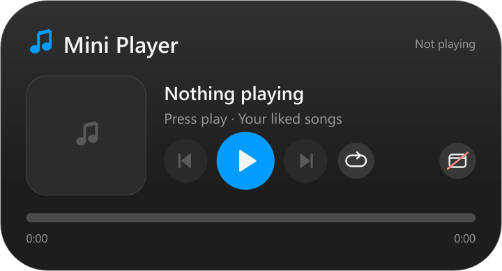

<div align="center">

# Mini Player Widget

**YouTube Music controls that feel at home on your desktop.**




*Clean sample state; no personal history or playlist is included.*

</div>

## Made for the desktop

Dark rounded cards, crisp vector rendering, a consistent blue accent and a quiet desktop presence. Each widget runs independently of ChatGPT or Codex, with no console window left open.

| Feature | What you get |
|---|---|
| Now playing | Artwork, title, artist, progress and playback controls. |
| Your playback | Previous/next, seek, shuffle loop and repeat one. |
| Companion mode | Optional pause during Focus Timer breaks. |
| Resilient sessions | Retries media-service startup and recovers from disappearing sessions. |

## Before you start

Windows desktop card built with PySide6. High-DPI vector rendering, draggable and lockable position, saved settings, and console-free logon startup.

Requires Google Chrome with YouTube Music installed as an app and signed in. Right-click to add your own playlist. The default Liked Songs list requires your account. Uses Windows media sessions; does not download audio. Playlist enumeration uses yt-dlp. Playback can depend on Chrome/YouTube changes.

## Install

Windows 10/11 and Python 3.11+ (tested with Python 3.14). In PowerShell:

```powershell
git clone https://github.com/guraygur0/mini-player-widget.git
cd mini-player-widget
```

Then install and enable automatic startup:

```powershell
powershell -ExecutionPolicy Bypass -File .\install.ps1
```

For an explicit interpreter: `-Python "C:\path\to\python.exe"`.
The installer installs requirements into that interpreter and registers `GurOS Mini Player` for your Windows account. It waits 20 seconds at logon, allows battery operation and retries failed exits. Run only one copy.

## Use

Right-click for settings, size, position lock and Quit. Local settings/history/cache live in `state/` and are never included in Git. Startup failures are recorded in bounded `state/crash.log` files. Quitting normally stops the widget until the next launch/logon.

To remove autostart:
```powershell
Unregister-ScheduledTask -TaskName 'GurOS Mini Player' -Confirm:$false
```

## Tests

```powershell
python -m unittest discover -s tests -q
```

Automated tests do not prove a real Windows reboot, a full focus session or all third-party playback/network behavior. No credentials, personal runtime state, screenshots or private history are distributed.

## Reliability and privacy

- Saved position and a right-click position lock.
- Desktop layer selection accounts for visible wallpaper WorkerW windows.
- A 20-second logon delay lets the Windows desktop initialize.
- Failed process exits retry through Task Scheduler; bounded local crash logs help diagnosis.
- 18 automated tests passed in this release. These are not a substitute for testing every Windows, account and wallpaper configuration.
- No analytics or telemetry service is added. Third-party requests are needed only for the widget's documented provider or playback features.

## The matching set

[AI limits](https://github.com/guraygur0/ai-limit-widget) · [Focus timer](https://github.com/guraygur0/focus-timer-widget) · [Mini player](https://github.com/guraygur0/mini-player-widget)

Found a problem? Open an issue with your Windows version, display scaling and steps to reproduce. Remove account identifiers and personal content before attaching logs.
